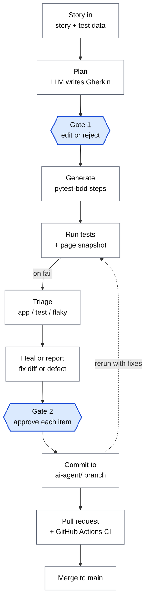

# AI QA Agent

An AI agent that turns a user story into reviewed, running Playwright tests, triages
failures, and proposes fixes or defect reports, with a person approving at two gates
and every change landing on a separate git branch that CI checks before it reaches `main`.

Built with Python, LangGraph, pytest-bdd and Playwright, tested against
[saucedemo.com](https://www.saucedemo.com), a public practice shop.

[](https://github.com/harneetbagga/ai-qa-agent/actions/workflows/tests.yml)

---

## Why I built it

AI can write test code quickly, but in my own trials it also wrote tests that passed
while checking almost nothing, invented steps and test data that didn't exist, and
confidently blamed the wrong root cause for failures. As a QA lead, the question I
care about isn't "can AI write tests?" but "where can it be trusted, and how do you
check it?" This agent is my answer: the AI drafts and proposes, a person decides.

## How it works



1. **Story in.** A Markdown file with the story, acceptance criteria and test data.
2. **Plan.** The model writes Gherkin scenarios: happy path, each criterion, negative and
   boundary cases. If the story doesn't give a value, it writes `[NEEDS DATA]` instead of
   inventing one.
3. **Gate 1.** I edit, keep or reject the scenarios. Nothing is generated until I approve.
4. **Generate.** The model writes pytest-bdd step definitions and any missing page-object
   methods. The code must pass `pytest --collect-only`; if not, the model gets one retry.
5. **Run.** On each failure the suite saves a Playwright trace, a screenshot, and the
   page's URL and HTML.
6. **Triage.** Failures with the same error are grouped. Each group is classified as
   app bug, test bug or flaky, with a confidence score, a reason and evidence.
7. **Heal or report.** Test bugs get a minimal fix as a diff; app bugs get a drafted
   defect report; flaky failures get a rerun.
8. **Gate 2.** I approve or reject each item. Approved items are committed to an
   `ai-agent/...` branch, and the tests rerun (up to two rounds).
9. **Merge.** The branch goes through a pull request, and CI must pass before `main`.

## Design decisions

| Decision | Why |
|---|---|
| **LangGraph** for orchestration | `interrupt()` pauses the workflow for human review and resumes with the decision; the gates are steps in the graph, not comments. |
| **Gates before generation and before any fix** | Those are the riskiest outputs: what gets tested, and changes to the tests themselves. |
| **Triage before healing** | A healer's job is to make failing tests pass. Without triage it would "fix" real app bugs by changing the test. Only failures triaged as test bugs are healed. |
| **Gherkin + pytest-bdd** | Matches the Cucumber stacks enterprises run, and business people can review scenarios at gate 1. |
| **Structured triage output** | A typed schema (category, confidence, reason, evidence) instead of free text. |
| **Heal rules** | The model may not weaken assertions, skip tests, change expected values to match the app, or add sleeps. Those are the ways an AI makes a test green while hiding a bug. |
| **Limited write access** | The model can only write in `pages/` and `tests/steps/`. |
| **Page snapshot on failure** | Triage from error text alone guessed wrong (see below). |
| **Git branch per run** | Every agent change is a commit with the triage reason, never on `main`, so there's an audit trail and a pull-request review. |
| **CI without AI** | GitHub Actions runs only the committed tests with test-only dependencies. No API key leaves my machine. |

## What I learned building it

**Confident, plausible, wrong triage.** 14 tests failed on the same "Add to cart"
locator. The triage agent produced 14 separate analyses, 13 of them "test bug" with
confidence 0.55–0.80, mostly blaming the product being "already in the cart from an
earlier test". That's impossible: every pytest-playwright test starts in a fresh browser.
The real cause was one line of configuration: saucedemo.com marks elements with
`data-test`, while Playwright's `get_by_test_id()` looks for `data-testid` by default.

What changed because of it:

- Triage now reads the page's URL and HTML at the moment of failure.
- Failures with the same error are grouped, so 14 identical failures are one decision.
- The triage prompt states known facts about the setup, such as fresh browser contexts.
- Proposals with no concrete change can't be approved, and only one fix per file is applied per round.
- And for me as the reviewer: a gate only protects you if you're willing to reject.

**The agent asking instead of guessing.** The story didn't say what happens when a
logged-out shopper tries to add to the cart. The planner wrote `[NEEDS DATA]`, triage
classified the failing test as incomplete, and the healer proposed nothing. I checked the
real behaviour and added it as an acceptance criterion. That's the intended behaviour:
people own business rules.

**Model output needs cleaning in code.** The model wrapped valid Gherkin in Markdown code
fences and varied its file-header format, so outputs are parsed defensively and raw answers
are saved for debugging.

## Project layout

```
agent/graph.py           the LangGraph workflows (full run, and triage & heal only)
prompts/                 plan, generate, triage, heal and defect prompts
review_app.py            Streamlit screen for both human gates
run.py                   full run from the terminal
triage_heal.py           triage & heal existing tests from the terminal
stories/                 user stories with acceptance criteria and test data
features/                approved Gherkin feature files
tests/steps/             generated pytest-bdd step definitions
tests/conftest.py        test-ID attribute setting and page snapshot on failure
pages/                   page objects
.github/workflows/       CI: runs the committed tests
```

## Running it

Requires Python 3.11+ and an API key for Claude or OpenAI.

```bash
python -m venv .venv && source .venv/bin/activate
pip install -r requirements.txt
playwright install chromium
cp .env.example .env          # add your API key and model
```

```bash
streamlit run review_app.py                     # review screen for both gates
python run.py stories/add_to_cart.md            # or: full run in the terminal
python triage_heal.py -k cart                   # triage & heal existing tests only
```

The agent switches to a new `ai-agent/<date-time>` branch before writing anything.
Review the commits, then push the branch and open a pull request.

## Status

- Working end to end on saucedemo.com; the committed suite passes in GitHub Actions.
- In progress: scoring triage accuracy against a labelled set of failures with known
  causes, using saucedemo's built-in faulty users.

## Built with

Python · LangGraph · LangChain · Playwright · pytest-bdd · Streamlit · GitHub Actions
